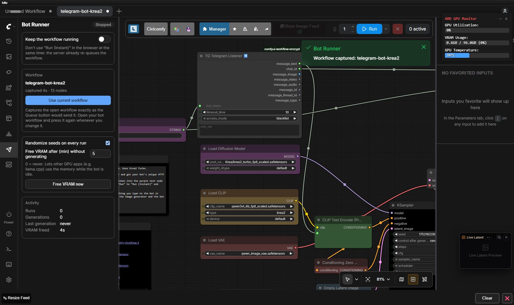
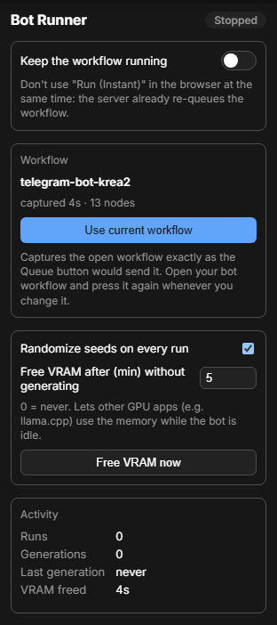
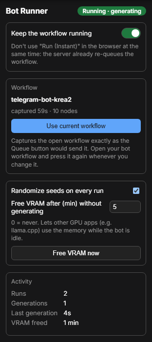

# ComfyUI Bot Runner

**Keep a workflow running from the ComfyUI server itself — no browser tab needed.**

Listener-style workflows (Telegram or Discord bots, folder watchers, webhooks…) are usually kept alive with
the frontend's **Run (Instant)** mode, which only works while a browser tab with ComfyUI stays open.
Close the tab, lose the connection, or restart ComfyUI and the bot stops answering.

Bot Runner moves that loop to the server: it re-queues one captured workflow every time the queue becomes
empty, survives closed tabs and restarts, and frees VRAM when the bot has been idle for a while so other
GPU apps (for example llama.cpp / llama-swap) can use the memory.



## Features

- 🔁 **Server-side loop** – re-queues the workflow whenever the queue is empty. Works with no browser open.
- 🧭 **Sidebar panel** – on/off switch, current workflow, settings and live activity.
- 📸 **One-click capture** – "Use current workflow" stores the open workflow exactly as the **Queue** button
  would send it (Get/Set nodes, bypassed groups and subgraphs are resolved by the frontend).
- 🎲 **Fresh seeds** – optionally randomizes every `seed` / `noise_seed` input on each run.
- 🧹 **Free VRAM when idle** – after *N* minutes without real generation work, models are unloaded and
  ComfyUI's caches are cleared, so the GPU memory is actually returned (also with `--highvram`).
- ♻️ **Resumes after restart** – if it was enabled, it starts again a few seconds after ComfyUI boots.
- 🛑 **Safe stop** – disables itself if ComfyUI rejects the workflow or after 3 consecutive execution errors.
- 🌐 Panel in English and Spanish (follows the browser language).

| Stopped | Running |
| --- | --- |
|  |  |

## Installation

**ComfyUI-Manager / Comfy Registry**

Search for **Bot Runner** in ComfyUI-Manager and install it, or with comfy-cli:

```bash
comfy node install comfyui-bot-runner
```

**Manual**

```bash
cd ComfyUI/custom_nodes
git clone https://github.com/Ramon-Balaguer/comfyui-bot-runner.git
```

Restart ComfyUI. There are no extra Python dependencies. A new **paper plane** icon appears in the left
sidebar.

## Usage

1. Build (or open) the workflow you want to keep running, for example a Telegram bot.
2. Open the **Bot Runner** tab in the sidebar and press **Use current workflow**.
3. Turn on **Keep the workflow running**.
4. Close the browser if you like — the server keeps re-queuing it.

Whenever you edit the workflow, press **Use current workflow** again: the runner always executes the last
captured version, not what is on the canvas.

> ⚠️ Don't use **Run (Instant)** in the browser at the same time — both would re-queue the workflow.

### Example: Telegram bot

Bot Runner pairs well with
[ComfyUI Autonomous Telegram Bot](https://github.com/CoolBreeze164/ComfyUI-Autonomous-Telegram-Bot), whose
**Telegram Listener** node waits for the next message and outputs its text / image / chat ID:

```
Telegram Listener ─ message_text ─► CLIP Text Encode ─► KSampler ─► VAE Decode ─► Send Image ◄─ chat_id
```

- When no message arrives within the listener's `timeout_time`, the run finishes doing nothing and Bot Runner
  queues the next one. A short timeout (≈20 s) keeps the queue responsive for jobs you start by hand.
- Use the listener's **whitelist** so only your chat IDs can use your GPU.
- Messages received while the runner is off are buffered by the listener and processed when it is turned
  on again (they are lost if ComfyUI restarts).
- Telegram rejects photos larger than 10 MB: send big images as JPG or as a document.

## How it works

```
             ┌─────────── queue empty? ───────────┐
             │                                     ▼
  Bot Runner loop (server, every 1 s) ──► POST /prompt (captured workflow, new seeds)
             ▲                                     │
             └──── run finished (history) ◄────────┘
```

- The captured workflow (API format plus the UI workflow for image metadata) and the settings are stored in
  `ComfyUI/user/default/bot-runner.json`.
- **Real work detection**: ComfyUI sends `progress` events only while samplers, VAEs or other long nodes are
  working — never while a listener just waits. Those events (from the bot *or* from jobs you queue in the UI)
  reset the idle timer, so VRAM is never freed under an active user.
- **Freeing VRAM**: the runner sets ComfyUI's `unload_models` + `free_memory` flags. The prompt worker only
  applies them after it finishes a queue item, so when nothing is queued the runner sends a tiny flush prompt
  (`PrimitiveInt → PreviewAny`). With `--highvram` this matters: unloading alone keeps the weights on the GPU;
  clearing the caches is what releases them. Measured on an AMD Strix Halo (gfx1151) with Krea 2:
  **21.4 GB → 0.6 GB** used after the idle period.
- The next message simply reloads the models (a "cold" run takes a few seconds longer).

## Settings

| Setting | Default | Description |
| --- | --- | --- |
| Keep the workflow running | off | Enables the server-side loop. |
| Randomize seeds on every run | on | Sets a new random value on every `seed` / `noise_seed` input of each run. |
| Free VRAM after (min) without generating | 5 | `0` disables it. |
| Free VRAM now | — | Unloads models immediately. |

## HTTP API

The panel uses a small API that you can also script:

| Method | Path | Body | Description |
| --- | --- | --- | --- |
| `GET` | `/bot-runner/status` | — | Settings, activity counters, last error, PyTorch VRAM usage. |
| `POST` | `/bot-runner/capture` | `{"name", "prompt", "workflow"}` | Store a workflow (`prompt` in API format). |
| `POST` | `/bot-runner/config` | `{"enabled"?, "randomize_seeds"?, "idle_free_minutes"?}` | Change settings. |
| `POST` | `/bot-runner/free` | `{}` | Free VRAM now. |

```bash
curl -s http://localhost:8188/bot-runner/status
curl -s -X POST http://localhost:8188/bot-runner/config -H "Content-Type: application/json" -d '{"enabled": false}'
```

## Troubleshooting

| Symptom | Cause / fix |
| --- | --- |
| The runner switched itself off | The panel shows the last error. ComfyUI rejected the workflow (missing model, invalid input) or it failed 3 times in a row. Fix it, capture again and turn it back on. |
| Telegram: *polling conflict* | Only one process may poll a bot token. Stop the other instance (another ComfyUI, a browser tab in Run (Instant)…). |
| Two jobs per message | Run (Instant) is also active in a browser tab. Turn it off. |
| VRAM is not freed | Something kept generating (the timer restarts with every `progress` event), or the setting is `0`. |

## Uninstall

Delete `ComfyUI/custom_nodes/comfyui-bot-runner` (and optionally `ComfyUI/user/default/bot-runner.json`) and
restart ComfyUI.

## License

[MIT](LICENSE)
